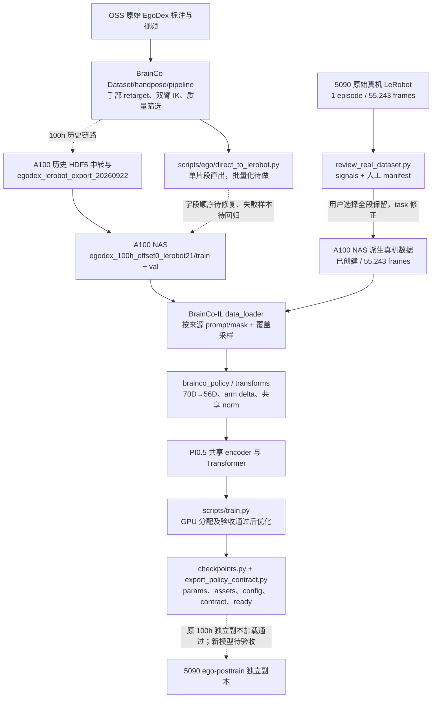

# Ego 100h 与 Post-train 架构及资产审阅（2026-09-29）

最新执行进展（2026-10-15）：三组共享 norm 前向、3 步短测、130 个状态数组保存恢复一致性、norm 绑定及部署加载均通过。用户指定 A100 5 卡，1:1 正式运行（已核验 step 10），之后串行 3:1、5:2；SwanLab 云端上传与补传通过。运行状态见 [TODO](POSTTRAIN_TODO.md)。

文档状态同步：2026-10-15。本文件维护设计与资产关系；运行证据在 [README 文档索引](README.md#文档导航与更新依据) 列出的 REPORT 中，剩余工作在 [TODO](POSTTRAIN_TODO.md)。数据/checkpoint 存在性已在 10 月 15 日复核；新直出问题依据 10 月 5 日审计。Post-train 代码已同步 A100，CPU 数据/统计/loader 准备完成。

## 路径与状态

实线表示现有代码或已确认数据，虚线表示历史路径、待审核同步或待回归的关系。没有以本图授权删除任何路径。

## 入口和引用

| 入口 | 当前用途与引用 | 建议 |
|---|---|---|
| `BrainCo-Dataset/scripts/ego/direct_to_lerobot.py` | 原始 annotation/MP4 单片段直出；调用 `egodex_reviewed.py`；10 月 5 日审计发现 42D 手指名称/数值顺序错配 | 先修复字段重排、排查派生数据并回归失败片段，再做 P2 批量调度 |
| A100 `/mnt/data_nas/ruibin/egodex_lerobot_export_20260922/export_egodex_receipts.py` | 100h 历史 HDF5 中转导出；文件存在，`docs/ego/README.md` 引用 | 保留回执与版本；退役前仍需完整引用核验 |
| `scripts/ego/prepare_100h_training.py`、`make_100h_profile.py` | 固定 100h 批次预检与历史 profile；旧文档引用 | 保留复现参数；可复用检查后续抽取 |
| `scripts/ego/run_egodex_reviewed_training.py`、`train_egodex_formal.py` | 2026-09-16 批次专用编排，引用 `logs/egodex_*` 等固定目录 | 标明历史用途，审阅引用后再考虑归档 |
| `scripts/train.py`、`src/openpi/training/{config,data_loader,coverage_sampler,checkpoints}.py` | 当前与未来训练主链 | 保留，新增字段默认兼容旧 YAML |
| `scripts/compute_norm_stats.py`、`compute_brainco_norm_stats_from_parquet.py` | 通用 loader 统计与快速 Parquet 统计 | 两条路径都保留；共享 1:1 norm 使用 `scripts/ego/compute_shared_norm.py`，已生成并通过真实 loader 的 CPU 一致性实测 |
| Mac/A100 `scripts/export_policy_contract.py`、旧 `src/openpi/deploy/plugin.py`；5090 `src/openpi/deploy/policy_inferencer.py` | 训练端封装与 5090 部署入口分属不同版本；5090 共享入口仍忽略旧 Ego mask，独立 `ego-posttrain/BrainCo-IL` 副本已修复 | 原 100h 独立副本完整加载与输出验收通过；共享部署入口未切换 |
| `tests/` 与脚本内验证 | 回归入口分散 | 保留并逐步统一，不直接搬迁 |

## 存储归属与审阅清单

| 资产 | 已核实状态 | 归属与处理建议 |
|---|---|---|
| OSS 原始 EgoDex 与历史中间产物 | 本次未逐项核验 OSS 资产，沿用 100h 交付记录 | OSS 管原始及历史中间产物；迁移前核对回执、SHA 与恢复方式 |
| NAS 100h train/val 与 checkpoint `.../19999` | A100 可读；train 为 10,809,850 帧、64,502 个 episode，最终 checkpoint 的配置、参数、norm 与 contract 存在 | NAS 是权威训练与模型存储；保持原路径 |
| 5090 真机原始 LeRobot | 本次可读，1 episode、55,243 帧、30 FPS，约 1.8 GB；3 视频各 55,243 帧 | 5090 原始副本保留；全段 task 修正版已派生并同步 NAS，源目录未改 |
| `/mnt/egodex_work/` 和 Mac 工作区调试副本 | 历史文档引用；部分为可重建 scratch | scratch 只放临时产物；迁移/清理先核对引用 |
| Mac `BrainCo-IL` 被忽略的 `logs/`、`runs/`、`assets/`、`_local_wuji_archive/` | 仍在仓库目录内，`logs/egodex_*` 被历史文档引用 | 先列文件清单与哈希，再决定保留/归档；本次未删除 |
| Mac `BrainCo-Dataset/third_party/hamer`、`third_party/openarm-mjcf` 空目录与系统缓存 | 本地检查为空；忽略缓存仍存在 | 低优先级审阅项，不影响训练准备 |

100h 数据、checkpoint、回执、历史脚本和日志均未移动或删除。旧链路退役取决于直出批量化验收及可恢复性核对。

## Provenance 术语

`physical_camera_missing` 指原始 EgoDex 没有真实腕部相机；`materialized_black_wrist_video` 指 LeRobot 出口已写入可解码的黑色腕部视频。二者可以同时为真。来源判定使用配置中的 `source_id`，不读取黑色像素做判断。

## 2026-10-15 CPU 准备完成

真机完整 55,243 帧按用户决定保留，只修正任务文本，派生数据已发布 NAS；Ego/真机仍独立目录。共享 1:1 norm 与三组真实混合 loader CPU 检查已完成。5090 独立副本原 100h 完整加载和腕 mask 不变性通过；新 norm 三组模型前向及训练等待已分配的 A100 GPU。
